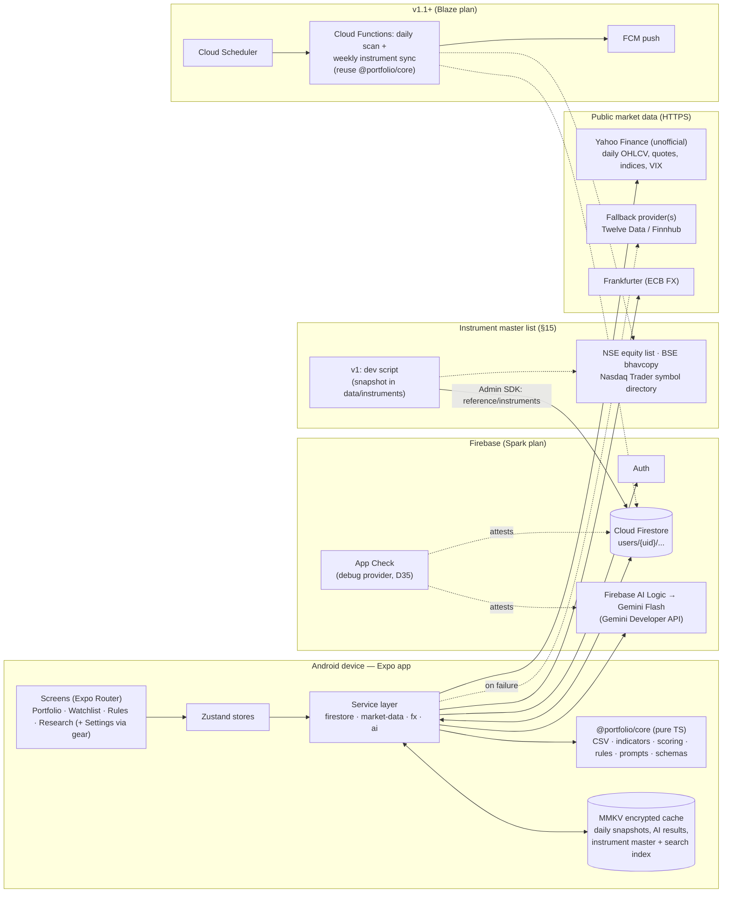
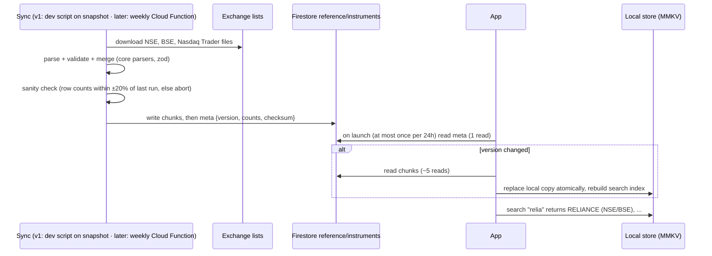

# High-Level Design (HLD): Portfolio & Watchlist Analyzer

> Status: **v1.8 — Signed off 2026-10-16, amended 2026-10-17** (v1.8: personal release signing key, D39; v1.7: System / Light / Dark appearance, D38; v1.4: App Check with the debug provider in personal builds, D35 supersedes D32; v1.5: Gemini model chain, D36; v1.6: static App Check debug token, D37, and the mandatory public-release checklist, §11 #7). Changes after sign-off go through the Decision Log (§12) and bump the version. History: v0.2 initial review · v0.3 CSV name column, filters, AI-rated Performance, package ID, news deferred · v0.4 instrument master list (§15) · v0.5 auth & holding actions (§16) · v0.6 labels-only badges, named watchlists, Cloud Function sync later · v0.7 currency display, daily/on-demand re-rating, duplicate rejection, rule scope, AI buy/sell signals · v0.8 individual BUY transactions (D30), Settings · v1.1 duplicate buys allowed with post-import heads-up and Undo import (D31, supersedes D27) · v1.2 App Check deferred to Play release (D32), scraped latest-close fallback and price-index benchmark (D33) · v1.3 AI market-sentiment paragraph on Watchlist (D34) · v1.4 App Check (debug provider) required for AI Logic in all builds (D35, supersedes D32) · v1.5 Gemini model chain across free-tier quotas (D36) · v1.6 static App Check debug token (D37) · v1.7 light / dark / system appearance (D38) · v1.8 release signing key (D39).

## 1. Executive Summary & Core Intent
An Android-first mobile app (Expo / React Native, TypeScript) for **personal** portfolio tracking across multiple brokers, covering Indian (NSE/BSE) and US markets. It consolidates holdings, shows P/L in INR and USD grouped **Sector → Stock → Lots**, runs a **deterministic technical + fundamental scoring** of each stock (pros/cons, R/G/Y), uses **Gemini Flash** to explain that analysis in plain language and to compile **natural-language rules** into safe JSON-Logic, and evaluates those rules on **daily closes**.

Personal use first; Play Store release is a possible later step, so public-release safeguards (feature flags, disclaimers, App Check seam) are designed in from the start. App Check protects Firebase AI Logic in every build (debug provider for personal builds, D35).

### Key capabilities
- Bulk CSV import (simple fixed format, §7) and manual single-stock add/edit/delete.
- Single consolidated portfolio grouped by sector, with per-stock CMP, P/L, % gain/loss and a colour-coded Performance badge (rated by Gemini), filterable by platform, market (India/US), exchange and sector.
- Every holding is shown in its **own currency** (₹ for NSE/BSE, $ for US). The INR/USD toggle applies only to the **overall portfolio summary** totals, converted with a dated FX rate.
- Stock Deep Analysis: technical + fundamental parameters scored against `docs/ANALYSIS_FRAMEWORK.md`, macro/VIX context, AI narrative.
- Natural Language Rule Studio: English → JSON-Logic (Gemini) → validated → evaluated locally.
- Multiple named, renamable watchlists with daily rule evaluation (in-app in v1; notifications in v1.1).
- Instrument master list (NSE, BSE, US tickers + company names) synced weekly to Firestore and cached on device, powering offline ticker/company search and CSV validation (§15).

## 2. Scope

| Release | In scope |
|---|---|
| **v1** | Auth (Google + email/password with verification and reset; optional biometric app lock), portfolio CRUD + CSV import, current holdings only, sector grouping, filters (platform / market / exchange / sector), daily-close prices, INR/USD, technical + fundamental scoring, AI narrative, Rule Studio, watchlist with in-app rule evaluation on app open/refresh, MMKV offline cache, multiple named watchlists, instrument master list + local search (loaded from a development snapshot; see §15). |
| **v1.1** | Daily notifications for triggered rules (see §9). Scheduled Cloud Function that refreshes the instrument master list (§15). |
| **Later** | Passkeys, "keep history" on remove (archived holdings), sell transactions & realised P/L, dividends/splits/corporate actions, news headlines & news-sentiment analysis, broker API sync, Play Store release hardening, iOS. |

**Non-goals (v1):** real-time/intraday prices, order placement, transaction history, tax reports, multi-user sharing, any server we operate ourselves.

## 3. System Architecture



### Component responsibilities
| Component | Responsibility |
|---|---|
| **Screens / features** | Presentation only; read from stores, call hooks. |
| **Zustand stores** | UI + session state; derived values via selectors. |
| **Service layer** | All I/O: Firestore repositories, market-data adapters (with provider fallback, rate limiting, caching), FX, Gemini client (structured output, retries, token caps). |
| **`@portfolio/core`** | Pure, deterministic logic shared with future Cloud Functions: schemas, CSV parsing, indicator calculation, parameter scoring & R/G/Y, JSON-Logic validation/evaluation, prompt builders. |
| **Firestore** | Source of truth for user data (holdings, watchlist, rules, settings). |
| **MMKV** | Local cache of daily market snapshots, AI results and the instrument master list; enables offline viewing and search. |
| **Instrument sync** | v1: a dev script builds the master list from the snapshot in `data/instruments/` and uploads it. Later: a scheduled Cloud Function downloads fresh lists weekly with the same `core` parsers (§15). |
| **Firebase AI Logic** | Proxies Gemini calls so no API key lives in the app; App Check enforced (D35). |

## 4. Data Model (conceptual — field-level schema is LLD)

All user data is nested under the user to make security rules trivial. The only shared data is the read-only instrument master list.

```
users/{uid}                      profile, baseCurrency, settings, feature flags
  └─ transactions/{txId}         one document per individual BUY: symbol, exchange, platform, type (BUY only in v1), quantity, price, tradeDate
  └─ watchlists/{watchlistId}    name (editable), sort order
       └─ items/{itemId}         symbol, exchange, target entry/exit, notes (a stock may be in several watchlists)
  └─ rules/{ruleId}              name, naturalPrompt, compiledLogic, appliesToPortfolio, appliesToWatchlists (= every watchlist), enabled
  └─ ruleResults/{date_ruleId}   (optional) last evaluation outcome per day

reference/instruments            shared, read-only for signed-in users; written only by the sync job
  └─ chunks/{chunkId}            packed instrument rows (≤ ~900 KB per doc)
```

**Sector → Stock → Broker → Buy hierarchy is a *view*, not a storage path.** Sector is an attribute of the instrument (from the data provider, overridable by the user), so it is stored on the holding and grouping happens in `core`. Storing sector as a Firestore path level would force document moves whenever a sector label changes and complicate queries.

UI hierarchy (one consolidated portfolio; filters on platform, market India/US, exchange and sector narrow every level and the totals):
```
Sector (total value, P/L, weight %)
  └─ Stock card (computed from the BUY transactions that match the active filters: total qty, weighted avg buy price, CMP, value, P/L, % P/L, XIRR, Performance label, Health label)
       └─ tap / ⋮ → Holding actions sheet (§16): Deep Research · Edit (buys grouped by broker) · Remove (all brokers)
```

There is **no separate holdings screen**: the Portfolio is the only list of holdings. **Transaction model:** every individual buy is stored as its own `BUY` transaction (stock, exchange, platform, quantity, price, trade date). Holdings are **never stored**; `core` derives them:
- **Stock card** = all of the stock's buys (matching the active filters) → total quantity, quantity-weighted **average buy price**, value, P/L.
- **Per-broker position** (used in Edit) = the same aggregation restricted to one platform.
- **Returns** use each buy's own date and amount: money-weighted **XIRR** for the stock and the portfolio, and benchmark comparison over the same cash-flow dates. This is accurate even when buys are years apart.

The portfolio view stays simple (one card, average price only); individual buys are visible only in Edit.

**Later (not v1):** add `SELL` (and dividend/split) transaction types to the same collection for realised P/L and a full trade history per stock. Because v1 already stores transactions with a `type` field, this needs no data migration.

Market snapshots (prices, indicators, fundamentals) are **cached on device**, not stored per-user in Firestore, keeping Firestore usage inside the free tier.

## 5. Processing Pipeline

1. **Fetch (service layer):** for each unique instrument, fetch ~1 year of daily OHLCV (enough for SMA-200) + quote/fundamentals; fetch indices (Nifty 50, S&P 500), India VIX, CBOE VIX and USD/INR. One refresh per day per instrument; cache keyed by `{symbol, exchange, sessionDate}`.
2. **Compute (core, deterministic):** holdings from BUY transactions, indicators (RSI-14, SMA-50/200, MACD, 52-week range, volatility), P/L, XIRR, performance vs benchmark, parameter scores and Health score per `ANALYSIS_FRAMEWORK.md`.
3. **Explain & rate (Gemini):** send only the computed numbers + labels.
   - *Deep Analysis* (per stock, on demand): structured JSON summary (overview, pros, cons, risks, optional alternatives behind a feature flag).
   - *Performance rating* (portfolio refresh, batched — up to ~25 holdings per call): `GOOD | AVERAGE | BAD` + one-line reason per holding, from the supplied return, benchmark return, holding period and Health score.
   - *Buy/sell signal* (Watchlist and Research, only when `features.aiSuggestions` is on): label + confidence + reason per stock (contract in `ANALYSIS_FRAMEWORK.md` §7.2).
   - *Market sentiment* (Watchlist, once per day): a short headline + paragraph written from the deterministic macro figures (VIX, index trend, USD/INR); no buy/sell or allocation wording (D34).
   - All validated with zod and cached per `{symbol, exchange, sessionDate}`; temperature 0 for ratings and signals. Ratings and signals are generated **once per day** on the first refresh after the session closes, and again **on demand** when the user taps refresh (which bypasses the day's cache).
4. **Rules:** NL prompt → Gemini → JSON-Logic → whitelist validation → user confirms a plain-English read-back → saved. Evaluated locally with `json-logic-engine` against each instrument's computed variables.

## 6. External Dependencies & Market Data

Usage estimate: ≤ 100 instruments, 1 refresh/day ⇒ ~100–300 HTTP calls/day. Every option below covers that.

| Need | Primary | Fallback | Notes |
|---|---|---|---|
| Daily OHLCV, CMP (NSE, BSE, US), indices, VIX | **Yahoo Finance** chart endpoint (no key; `RELIANCE.NS`, `500325.BO`, `AAPL`, `^NSEI`, `^INDIAVIX`, `^GSPC`, `^VIX`) | **Twelve Data** free key (≈800 req/day, 8/min), then **latest close scraped from a public quote page** (D33) | Yahoo is unofficial — no SLA, may change/break. Adapter interface allows swapping without touching the app. |
| Fundamentals (P/E, P/B, ROE, D/E, margins, growth) | Yahoo quote/summary modules (best effort; needs cookie/crumb) | **Finnhub** free key (≈60 req/min) for US basic financials | Indian fundamentals coverage on free APIs is patchy → missing values shown as "insufficient data", never guessed. Fundamentals are cached for 7 days (they change quarterly). |
| FX USD/INR | **Frankfurter** (ECB rates, no key) | Yahoo `USDINR=X` | Daily rate with `asOf` date. |
| LLM | **Gemini Flash** via Firebase AI Logic (Gemini Developer API) | — | Model name in config/Remote Config. Free tier is rate-limited; caching keeps usage low. |

Limits above are approximate — verify on each provider's site at sign-up. Free provider keys in a client bundle are acceptable for personal use; before a public release, move market data behind a Cloud Function proxy.

> **Note:** a Gemini consumer subscription (Gemini app / Google AI plans) does **not** include API access. The app uses the Gemini Developer API through Firebase AI Logic, which has its own free tier.

## 7. CSV Import Format (v1)

One row = one individual buy. Header row required. UTF-8.

| Column | Required | Example | Notes |
|---|---|---|---|
| `symbol` | ✔ | `RELIANCE`, `AAPL` | Exchange ticker — the identifier used for data lookups. |
| `name` | ✔ | `Reliance Industries Ltd` | Full company name, for display. Not used for lookups. |
| `exchange` | ✔ | `NSE` \| `BSE` \| `NASDAQ` \| `NYSE` \| `NYSE_ARCA` \| `NYSE_AMERICAN` \| `CBOE` | Determines currency & provider symbol. US ETFs are mostly on NYSE Arca. |
| `quantity` | ✔ | `10` | > 0, fractional allowed for US. |
| `buy_price` | ✔ | `2450.50` | Per share, in the instrument's currency. |
| `buy_date` | ✔ | `2024-03-15` | ISO date, not in the future. |
| `platform` | ✔ | `Zerodha` | Broker/app. |
| `sector` | – | `Energy` | Optional override; otherwise from provider. |

**Import flow (no separate import screen):**
1. Portfolio **+** button expands into **Add stock** and **Upload CSV**.
2. **Upload CSV** opens the Android system file picker (`expo-document-picker`; Downloads, Drive, etc.), restricted to `.csv` / `text/*`, max 1 MB.
3. The file is parsed and every row validated (schema, master list §15, dates, numbers).
4. **All-or-nothing:** if every row is valid, all rows are imported in one batch and a toast confirms "45 buys imported" (plus the duplicate heads-up and **Undo import**, see below). If any row has an error, **nothing is imported** and an error sheet lists every problem as *row · column · issue · suggested fix*. The user fixes the file and uploads again.

Each row becomes one `BUY` transaction:
- The same stock bought several times (different dates, prices or platforms) is simply several rows. That is normal, not an error.
- Identical buys (same stock, exchange, platform, date, quantity, even price) are **allowed**, because they can genuinely happen; the user can edit or delete any buy later (D31).
- After a successful import, rows that look like duplicates of existing buys (or of each other) produce a **non-blocking heads-up**: "45 imported · 3 look like duplicates of existing buys" with **Review** (shows them) and **Undo import** (deletes every buy from this upload, via its `importBatchId`).

**Suggested fixes are deterministic** (computed by `core`, no AI call):

| Problem | Example | Suggested fix |
|---|---|---|
| Missing/renamed header | `Qty` | "Rename column `Qty` → `quantity`" (common aliases recognised: qty, price, avg_price, date, broker) |
| Date format | `15/03/2024` | "Use `2024-03-15` (YYYY-MM-DD)" |
| Exchange suffix in symbol | `INFY.NS` | "Set symbol `INFY`, exchange `NSE`" |
| Unknown symbol | `RELIANCEIND` | "Did you mean `RELIANCE` (Reliance Industries, NSE)?" — closest master-list matches |
| Symbol not on that exchange | `AAPL`, `NSE` | "`AAPL` is listed on `NASDAQ`" |
| Name mismatch | `Infosys Technologies` | Warning only: "Master list name is `Infosys Ltd`" (does not block import) |
| Bad number | `1,680.00` with a stray char, `-5` | "Quantity must be a positive number" |
| Future date / zero price | | Explicit message per field |


Warnings (e.g. name mismatch) never block an import; errors always do.

## 8. Analysis & Colour Coding
Defined in `docs/ANALYSIS_FRAMEWORK.md`. Two separate badges per stock, so "the stock went up" is never confused with "the stock is healthy":
Cards show **labels only** (no numbers); the 0–100 Health score, every parameter and the Performance reason in full are on the Research screen (S04).
- **Performance (Good / Average / Bad) — rated by Gemini:** the model receives deterministic inputs (holding return, benchmark return over the same period, holding period, Health score) and returns `GOOD | AVERAGE | BAD` with a short reason. If AI is unavailable or the output fails validation, the badge shows ⚪ "Not rated" — the app never invents a rating.
- **Health (Good / Average / Bad) — deterministic:** label derived from the weighted technical + fundamental score (0–100, shown in Research), with the parameters behind it listed as pros/cons.

The filter sheet filters by these labels (e.g. Performance = Bad), not by numeric score bands.

## 9. Notifications (v1.1) — Recommendation

| Option | How | Cost / plan | Trade-off |
|---|---|---|---|
| **A. On-device (recommended for v1.1)** | `expo-background-task` runs once a day after market close → fetch closes → evaluate rules with `core` → `expo-notifications` local notification | Free, stays on Spark plan, no server | Android may delay background work by hours (Doze); acceptable for daily-close alerts. |
| **B. Server push (before Play Store)** | Cloud Scheduler → Cloud Function (reuses `@portfolio/core`) → FCM | Requires **Blaze** plan (usage stays within free quotas; set a budget alert) | Reliable timing, works when the app hasn't run; market-data calls move server-side. |

Two schedules are needed either way: after NSE close (~16:00 IST) and after US close (~16:30 ET).

## 10. Non-Functional Requirements

| Area | Target |
|---|---|
| Scale | 1 user (v1); ≤ 100 stocks / ≤ 500 buy transactions, ≤ 50 watchlist items, ≤ 25 rules. |
| Data freshness | Last completed daily session; refresh at most once per instrument per session (manual force-refresh allowed). |
| Performance | Cached portfolio screen renders < 1 s; full refresh of 100 instruments < 30 s with progress UI; local indicator + rule evaluation < 50 ms per instrument. |
| AI | Analysis response < 10 s; ≤ 1 generated analysis and ≤ 1 performance rating per stock per day (cached); performance ratings batched (≈ 4 calls for 100 holdings); `maxOutputTokens` cap per call; ≤ 2 retries on invalid output. |
| Offline | Last snapshot and holdings viewable offline; edits queued via Firestore offline persistence. |
| Cost | ₹0 in v1: Firebase Spark, free market-data tiers, Gemini free tier. |
| Reliability | Market-data provider failure falls back to secondary provider, then to the cached snapshot with a "stale as of" banner. |
| Security / privacy | Data only under `users/{uid}`; App Check enforced on AI Logic in all builds (D35; Firestore enforcement later); no PII sent to Gemini (only tickers and numbers). |
| Retention | User data kept until the user deletes it; account deletion removes `users/{uid}` recursively. |
| Search | Ticker/company search over ~20k instruments returns top 20 results in < 50 ms, fully offline after first sync. |
| Master-list freshness | v1: static development snapshot, uploaded manually. Later: refreshed weekly by a Cloud Function. Device checks at most once per 24 h (1 Firestore read) and downloads only when the version changed (~5 reads). |

## 11. Security, Privacy & Compliance
1. **App Check** protects Firebase AI Logic from non-app clients in **every build** (D35): Firebase requires App Check for AI Logic from 2026-11-02. Personal builds are sideloaded, so Play Integrity can't attest them; they use the **debug provider**, and each device's debug secret is registered once in the console (never committed). Firestore stays protected by Auth + security rules; enforcing App Check on Firestore (and Play Integrity) waits for a Play release, if any.
2. **Firestore rules:** `match /users/{uid}/{document=**} { allow read, write: if request.auth != null && request.auth.uid == uid; }` plus per-collection field validation (LLD). `reference/**` is read-only for signed-in users and never writable from clients (the sync job uses the Admin SDK). Tested with the emulator.
3. **No unsafe execution:** AI rules are JSON-Logic only, validated against a whitelist of variables and operators; never `eval`.
4. **Prompt injection:** user-written rule text is passed as a delimited data field; output must match a strict schema.
5. **Compliance:** analysis shows a "for personal information, not investment advice" disclaimer. AI stock suggestions **and buy/sell signals with confidence** are behind `features.aiSuggestions` (on for personal builds, off by default for public release). Confidence is the model's own self-reported estimate, labelled as such in the UI, not a statistical probability. Using Yahoo's unofficial endpoints is acceptable for personal use; a public release needs a licensed data provider.
6. **Sync credentials:** the dev upload script uses Application Default Credentials from the developer's own `gcloud` login (no key file anywhere); the later Cloud Function uses its built-in service identity (no key file). Neither is ever in the repo or the app.
7. **Before a public (production) release — mandatory checklist.** None of these may ship in a Play Store build:
   - **App Check:** switch from the debug provider to **Play Integrity**; remove `EXPO_PUBLIC_APPCHECK_DEBUG_TOKEN` from the build and **revoke every debug token** in the console (D37); consider enforcing App Check on Firestore too.
   - **Client-bundled keys:** move market-data provider keys (Twelve Data, Finnhub) behind a server/proxy (§6).
   - **Market data:** replace Yahoo's unofficial endpoints and the quote-page fallback with a licensed provider (#5).
   - **Feature flags:** `features.aiSuggestions` off by default (#5, D29).

## 12. Decision Log

| # | Decision | Alternatives | Rationale |
|---|---|---|---|
| D1 | Expo managed + development builds | Bare RN CLI | Native modules (RNFirebase, MMKV) via config plugins without maintaining `android/`. |
| D2 | Zustand | Redux Toolkit | Small app, less boilerplate. |
| D3 | Firebase (Spark) + Gemini via Firebase AI Logic | Own backend (FastAPI), other LLMs | User preference; free tier; no API key in the client. |
| D4 | Data nested under `users/{uid}`; holdings = one doc per position (superseded in detail by D21) | Holdings array inside a portfolio doc; sector as a path level | Avoids 1 MB doc limit & write contention; simple security rules; sector is an attribute. |
| D5 | Pure-TS `@portfolio/core` in an npm-workspaces monorepo | Logic inside the app | Testable; reused by v1.1 Cloud Functions without duplication. |
| D6 | Deterministic Health score; LLM explains it | LLM scores stocks | Reproducible, testable, no hallucinated numbers. |
| D7 | Yahoo primary + pluggable fallbacks | Alpha Vantage (≈25 req/day free), paid APIs | Only free source covering NSE+BSE+US daily data; adapter isolates the risk. |
| D8 | Daily closes only, current holdings only (v1) | Intraday, transactions | User scope decision. |
| D9 | Notifications deferred to v1.1, on-device first | FCM in v1 | FCM path requires Blaze plan + server-side data fetch. |
| D10 | Gemini model name in config (`gemini-1.5-flash` retired) | Hard-coded model | Models are retired regularly; Remote Config can override without a release. |
| D11 | Performance badge rated by Gemini from deterministic inputs (batched, temp 0, cached daily, ⚪ fallback) | Fixed benchmark-relative thresholds | User decision: qualitative judgement across return, benchmark, holding period and health. Guardrails keep it bounded and grounded. |
| D12 | One consolidated portfolio with filters (platform, market, exchange, sector) | Multiple named portfolios | User decision; simpler data model, filters cover the use cases. |
| D13 | CSV carries both `symbol` (lookup) and `name` (display) | Name only | Names are ambiguous for data lookups. |
| D14 | Android application ID `com.myportfoliotracker.app` | `com.portfolioanalyzer.app` | User decision. Permanent once published on Play Store. |
| D15 | News headlines/sentiment deferred to "Later" | v1 | User scope decision. |
| D16 | Instrument master list in Firestore (`reference/instruments`, packed chunks) + full local copy on device | Search API per keystroke; one Firestore doc per instrument | Offline, instant search; ~5 reads per weekly refresh instead of ~20k; no third-party search dependency. |
| D17 | v1: master list built from a committed development snapshot and uploaded by a script; later: scheduled Cloud Function refreshes it weekly | GitHub Actions cron; Cloud Storage file | User decision. Keeps v1 simple and on the free Spark plan; Cloud Functions need the Blaze plan (free quota covers this job). Same `core` parsers are reused, so the switch is small. |
| D18 | CSV import is all-or-nothing with per-row errors and deterministic fix suggestions; entry via the expandable + button | Preview screen with partial import | User decision: simpler UX, no half-imported portfolios; re-upload is safe thanks to duplicate skipping. |
| D19 | Firebase Auth with Google + email/password (email verification, password reset); biometric = local app lock only; passkeys later | Biometric/passkey as sign-in methods in v1 | Firebase Auth supports Google and email/password natively on the free plan. Biometrics can only unlock an existing session on the device; they are not an account credential. |
| D20 | Holding actions sheet: Deep Research, Edit (per broker), Remove (hard delete in v1; "keep history" shown disabled) | Inline lot editing on the card; soft delete in v1 | User decision. Keeps the card clean; archiving needs realised-P/L logic that is out of v1 scope. |
| D21 | ~~One position per stock per broker~~ (superseded by D30) (own qty, avg buy price, buy date); Remove = all brokers, partial removal via per-broker Edit | Multiple buy lots per broker; filter-scoped remove | User decision; mirrors broker holding statements and keeps editing simple. |
| D22 | Cards show Good / Average / Bad labels only; numeric scores in Research | Numbers on cards | User decision; cleaner cards, detail on demand. |
| D23 | Multiple named, renamable watchlists in v1; a stock may appear in several | Single watchlist | User decision. |
| D24 | Exchange enum adds `NYSE_ARCA`, `NYSE_AMERICAN`, `CBOE` | NSE/BSE/NASDAQ/NYSE only | Nasdaq Trader data shows many US stocks/ETFs (e.g. SPY) list there. |
| D25 | Holdings in native currency; INR/USD toggle only for the portfolio summary | Convert every row to one base currency | User decision; avoids FX noise on per-stock numbers. |
| D26 | AI ratings/signals generated once per day, plus on-demand refresh | Only daily; only on demand | User decision. On-demand refresh bypasses the cache; still capped by `maxRetries` and token limits. |
| D27 | ~~CSV rows exactly matching an existing buy reject the whole upload~~ (superseded by D31) | Skip silently | User decision; makes accidental double-imports visible. |
| D28 | Rules apply to the portfolio and/or **all** watchlists (no per-watchlist targeting) | Pick specific watchlists | User decision; simpler rule model. |
| D29 | AI buy/sell signal labels with confidence %, behind `features.aiSuggestions` | No buy/sell language | User decision for personal use. Enum labels + schema validation + disclaimer; off for public release. |
| D30 | Store every individual buy as a `BUY` transaction; derive holdings, average price and XIRR in `core`; SELL/dividends later in the same collection | One position per broker (D21) | User decision. Accurate money-weighted returns, simple portfolio view (average price only), and a direct path to full buy/sell history without migration. |
| D31 | Duplicate buys allowed (CSV and manual); non-blocking duplicate heads-up after import + one-tap **Undo import** | Reject duplicates (D27) | User decision: identical buys can be real. Undo import (by `importBatchId`) covers accidental double uploads. |
| D32 | App Check not used in personal builds; Play Integrity App Check enforced for Firestore + AI Logic from the Play release | Debug-provider App Check with enforcement in v1 | User decision. Personal sideloaded app; Firestore is protected by Auth + rules, and the Spark project has no billing, so the residual risk is free-quota abuse only. |
| D33 | Last-resort price fallback: scrape the latest close from a public quote page when Yahoo and Twelve Data both fail; benchmark uses price indices (bonuses/dividends not considered) | Cached snapshot only; total-return indices | User decision. Scraping is fragile and against some sites' terms, so it is isolated in one adapter, used only after the market has closed, and updates price/P&L only (indicators stay on cached bars). |
| D34 | Watchlist market card shows a Gemini-written headline + paragraph (daily, cached, grounded) above deterministic VIX/index/FX figures | Figures only | User decision: friendlier. One extra call per day; level colours stay deterministic; no advice wording. |
| D35 | App Check with the **debug provider** in all personal builds (dev and release), passed to Firebase AI Logic; each device's debug secret registered in the console. Supersedes D32 | Un-enforce App Check (D32); Play Integrity | Firebase requires App Check for AI Logic from 2026-11-02 and blocks un-enforcing it; the project already had enforcement on. The app is not distributed through Google Play (user decision, 2026-10-17), so Play Integrity can't attest it. Free; no billing. |
| D36 | Gemini **model chain**, best first: gemini-3.8-flash → 3.7-flash (20 req/day each) → 3.5-flash-lite → 3.1-flash-lite (500/day each); gemini-2.5-flash was dropped after a probe returned 404 for this project. Every task uses the first model with quota left and steps down as each runs out; per-model counters follow the Pacific-time quota day, so the chain starts at the top again each day. A 429 cools that model down for an hour; an unknown model (404) is skipped. | One model with a 500/day cap; paid tier (billing) | The free tier allows only 20 requests/day per Flash model (found 2026-10-17); quotas are per model, so the chain gives ~1,040/day for free. Model-specific settings (e.g. minimum thinking level) are kept in `config/ai.ts`, found with a dev probe, never learnt into the cache. User decision, 2026-10-17. |
| D37 | A **static App Check debug token** for personal builds: generated in the console, kept in the git-ignored `apps/mobile/.env.local` as `EXPO_PUBLIC_APPCHECK_DEBUG_TOKEN` and passed to the debug provider, so every build and device works without reading logcat; empty = the SDK's random per-install secret (D35). | Register each install's random secret from logcat | One registration covers dev and release APKs on any device. The token is public in the APK: acceptable while APKs stay on the user's devices; revoke it if one is shared. Never in a public release — Play Integrity instead (§11 #7, mandatory). User decision, 2026-10-17. |
| D38 | Appearance setting **System · Light · Dark** (default System), stored on the device only and reset by "Clear local cache"; a hand-built light palette in the Obsidian style (status colours darkened to WCAG AA); splash follows the phone's mode. Supersedes "dark theme only in v1" (LLD §4.10 #4) | Dark only; preference synced via Firestore; splash always dark | User decision, 2026-10-17. Phones and lighting differ, so a per-device choice fits; no Stitch light designs exist, so the light palette is derived from the dark tokens. Details: LLD §4.17. |
| D39 | Release APKs are signed with a **personal upload key** (`D:\learning\keys\my-portfolio-release.jks`, PKCS12, RSA 2048, ~27 years) kept outside the repo with its passwords in a sibling `.properties` file; a config plugin (`apps/mobile/plugins/withReleaseSigning.js`) wires it into Gradle on every prebuild, falling back to the debug key when the file is absent. Its SHA-1/256 are registered in Firebase next to the debug ones | Keep signing release builds with the shared template debug key; EAS-managed credentials | User decision, 2026-10-17. The debug key is public, so anyone could sign an "update" for the app; an own key also becomes the Play upload key later. Losing the key or password blocks in-place updates, so the user backs both up. |

## 13. Open Questions
None blocking. Remaining details (field-level schemas, error codes, exact UI copy) are resolved in the LLD.

## 14. UI Reference
Screen designs (Google Stitch: PNG + HTML per screen, shared `DESIGN.md`) live in `docs/ui/screens/<stitch_folder>/`; `docs/ui/README.md` maps each folder to its screen ID. The LLD references screens by ID.

## 15. Instrument Master List

**Purpose:** fast, offline search by ticker or company name (Add stock, Research, Watchlist add) and validation of CSV imports, without calling a search API or Firestore on every keystroke.

### Sources (public, free, no API key)
| Market | Source | Contents | Notes |
|---|---|---|---|
| NSE | NSE equity list CSV (`EQUITY_L.csv`, NSE archives) | symbol, company name, series, ISIN | 2,605 rows (verified 2026-10-16). NSE sometimes blocks cloud IPs. |
| BSE | BSE daily equity bhavcopy (UDiFF CSV) | scrip code, ticker, ISIN, name | 5,048 stocks (verified). Only scrips traded that day. BSE's "List of Scrips" API returns 403 to scripts, so it is not used. Provides the numeric code Yahoo needs (`500325.BO`). |
| US | Nasdaq Trader symbol directory (`nasdaqlisted.txt`, `otherlisted.txt`) | symbol, name, exchange, ETF flag | 13,306 rows (verified). Official, updated daily; NASDAQ, NYSE, NYSE American, NYSE Arca, Cboe. |

After merging NSE/BSE by ISIN (2,423 overlap): **≈ 18.5k instruments**. Raw development snapshot and column notes: `data/instruments/`.

Sector is **not** in these lists (except BSE industry). Sector for instruments you hold or watch is fetched from the market-data provider and cached; the user can override it.

### Normalised record (conceptual)
`{ name, isin?, type: EQUITY | ETF, listings: [{ exchange: NSE | BSE | NASDAQ | NYSE, symbol, providerCode? }] }`. Indian companies listed on both NSE and BSE are merged by ISIN into one record with two listings.

### Flow


### Behaviour
- **Search ranking:** exact symbol, then symbol prefix, then name word-prefix, then name contains; top 20; India/US filter respected.
- **CSV import:** each row's `symbol + exchange` is checked against the master list. Unknown symbols are flagged in the preview (not silently dropped); a mismatched `name` shows a warning with the master-list name.
- **Delisted / renamed:** a holding whose instrument disappears from the list is flagged "not in latest exchange list", never deleted.
- **Safety:** the job writes the meta doc **last**, so devices never see a half-written version; a failed sanity check leaves the previous version live.
- **First launch / offline:** search shows "Downloading stock list…" until the first sync completes. A bundled seed file can be added later if needed.


## 16. Authentication & Holding Actions

### Sign-in and registration (S01, S01a)
| Method | v1 | Notes |
|---|---|---|
| Google sign-in | ✅ | Firebase Auth. Needs the app's SHA-1/SHA-256 fingerprints registered in Firebase. |
| Email + password | ✅ | Sign-up asks for name, email and password (≥ 8 chars, 1 number, 1 symbol). **Email verification** is required before first use; **Forgot password** sends Firebase's reset email. |
| Biometric app lock | ✅ optional | After the first sign-in, a Settings toggle requires fingerprint/face unlock when the app opens (`expo-local-authentication`). It unlocks the existing Firebase session; it is not a separate account credential, so it cannot be used to *create* an account. |
| Passkeys | Later | Not natively supported by Firebase Auth; revisit before a public release. |

"Remember this device" is Firebase's default persistent session; signing out clears it and the local MMKV cache.

**Copy rules (accuracy):** screens must not claim protections the app does not have. Remove "256-bit end-to-end / zero-knowledge" and "SEC/SEBI custodial protection" wording: Firestore data is encrypted at rest and in transit by Google, but it is **not** end-to-end encrypted, and the app is not a regulated custodian. Terms of Service / Privacy Policy links are needed before a Play Store release (a privacy policy is mandatory there); for personal builds the checkbox can be hidden.

### Holding actions sheet (S02b)
Opened from a Portfolio stock card (tap or ⋮). Acts on one stock.

| Action | Behaviour |
|---|---|
| **View deep research & rules** | Opens Research / Deep Analysis (S04) for the stock, including the rules that apply to it. |
| **Edit** | Shows the stock's buys **grouped by broker**: each broker header shows that broker's total quantity and average price, with its individual buys (date, quantity, price) underneath. Each buy can be edited (quantity, price, date, broker) or deleted. "Remove from <broker>" deletes all of that broker's buys for the stock. "Add buy" adds a new purchase on any broker. |
| **Remove from portfolio** | Always removes the stock from **all brokers**, regardless of active filters. Two options: **Delete all records** (v1: hard-deletes every buy transaction of the stock after a confirmation listing them, e.g. "Removes 3 buys of Reliance on Zerodha (120 shares) and 1 on Groww (30)") and **Keep history** (shown **disabled** with a "Coming later" label). Partial removal is done via Edit. |

**"Keep history" seam for later:** v1 hard-deletes the stock's transactions. The later version will keep them (and record SELL transactions instead of deleting), so past positions and realised P/L remain available. The transaction model above already supports this; no migration is needed.
